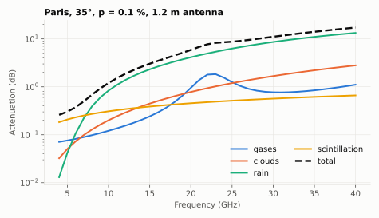

# Combined attenuation: `Itur`

`Itur.atmosphericAttenuationSlantPath(lat, lon, f, el, p, D, Options)` computes gases (P.676), clouds (P.840), rain (P.618) and scintillation (P.618) at the same probability and combines them as in P.618 §2.5:

```
A = Ag + sqrt((Ar + Ac)² + As²)
```

Gases, clouds and vapour use `max(1, p)` because their statistics are only defined for p ≥ 1 %.



Rain dominates above ~10 GHz, gases peak at the 22 GHz water line, scintillation matters mostly at low elevation.

## Example

Paris, 20 GHz, 35°, p = 0.1 %, 1.2 m: gases 0.95, clouds 0.78, rain 4.14, scintillation 0.45 → **5.89 dB** (a plain sum would give 6.32 dB).
