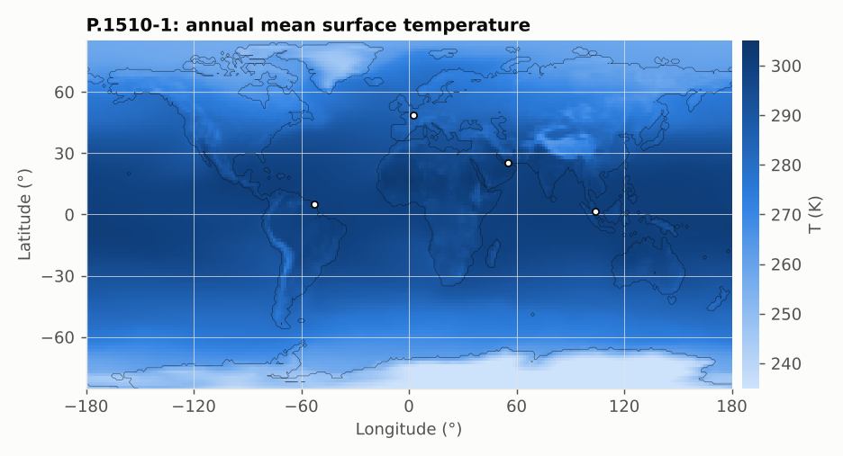
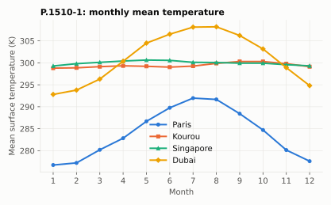

# P.1510-1: mean surface temperature

**Class** `P1510` · **Output** temperature in K

Annual mean and 12 monthly means of the surface (2 m) temperature on a 0.75° grid, bilinear interpolation, longitude folded to −180..180.

The seasonal cycle is large at mid-latitudes and in Dubai, negligible near the equator.

## API

`surfaceMeanTemperature(lat, lon)`, `surfaceMonthMeanTemperature(lat, lon, month)` with month 1..12.

## Example

Paris: annual 284.03 K, January 276.73 K, July 291.97 K.

## Caveats

The grid is stored as float32 (agreement with the ITU tables ≤ 1.3e-5 K).
