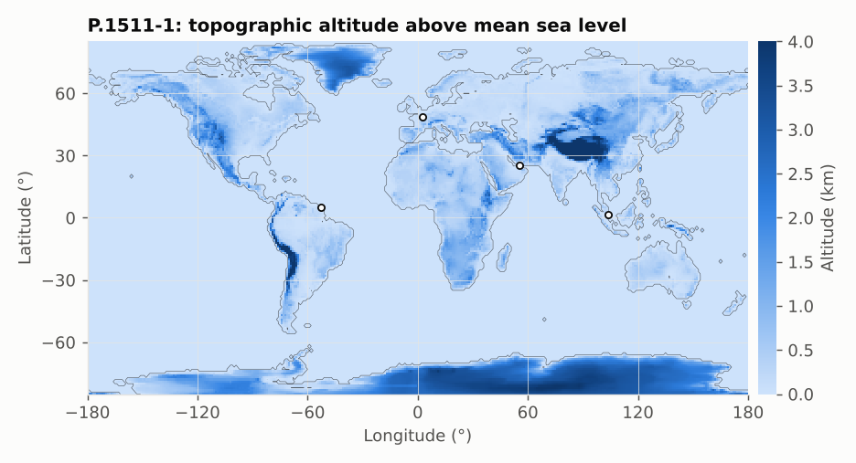

# P.1511-1: topography for Earth–space propagation

**Class** `P1511` · **Output** height of the ground above mean sea level, in km

A 0.5° grid of altitudes interpolated with a bicubic (Keys) kernel, which gives smoother results than bilinear. The result is floored at 1e-9 km so that sea level is not exactly zero (compatibility with ITU-Rpy).

This map also provides the land outline used in the other maps of this guide.

## API

`topographicAltitude(lat, lon)`.

## Example

Paris 0.085 km, Denver 1.671 km, mid-Atlantic ≈ 0 (1e-9 km).

## Use

Station height `hs` in P.618, altitude correction in P.836.
