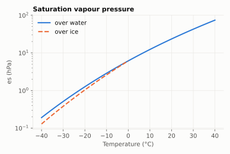
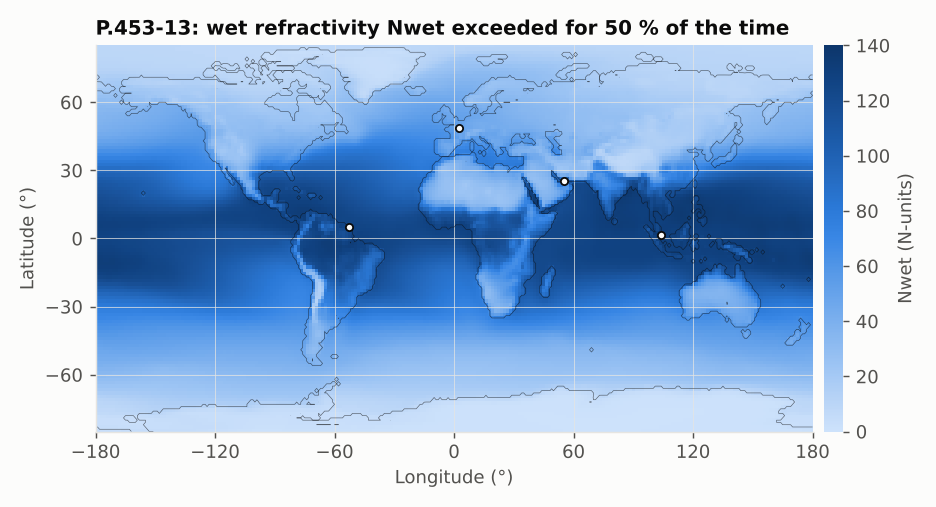

# P.453-13: radio refractive index

**Class** `P453` · **Output** refractivity in N-units, vapour pressure in hPa

The refractive index n is written as `N = (n − 1)·10⁶ = Ndry + Nwet`:

```
Ndry = 77.6 · Pdry / T            Nwet = 72·e/T + 3.75e5·e/T²
```

with `e` the water vapour pressure (hPa), derived from relative humidity H and the saturation pressure es over water or ice (`saturationVapourPressure`, exponential fit `ef·a·exp((b − T/d)·T/(T + c))` with an enhancement factor `ef` that depends on pressure; separate coefficients for water and ice).





Nwet is the part that varies: below 30 N-units in deserts and polar regions, above 100 near the equatorial oceans.

## API

| Method | Notes |
|---|---|
| `saturationVapourPressure(T, P, WATER/ICE)` | hPa, T in °C |
| `waterVapourPressure(T, P, H)` | hPa |
| `wetTermRadioRefractivity(e, T°C)` | temperature in °C, as in ITU-Rpy |
| `dryTermRadioRefractivity(Pdry, T)` | N-units |
| `radioRefractiveIndex(Pdry, e, T)` | n |
| `mapWetTermRadioRefractivity(lat, lon, p)` | map value |
| `dn65(lat, lon, p)`, `dn1(lat, lon, p)` | refractivity gradients for propagation effects |

## Example

15 °C, 1013.25 hPa, 60 % humidity: es = 17.122 hPa, e = 10.273 hPa, Nwet = 48.96, Ndry = 270.11, n = **1.0003191**. Map: Paris Nwet (50 %) = 51.7 and (1 %) = 93.9. dN65 (1 %) = −161.2.

## Caveats

Maps give NaN at the grid limits (lat = −90). The wrap of longitude 180° is handled (earlier NaN bug fixed).
