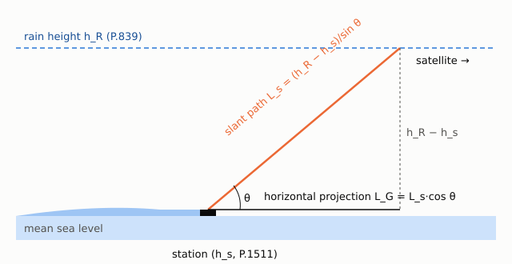
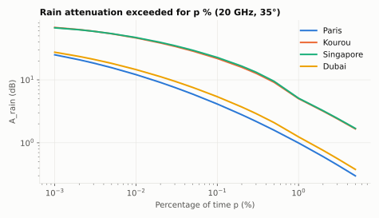
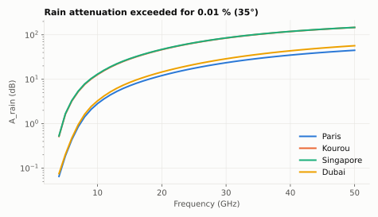
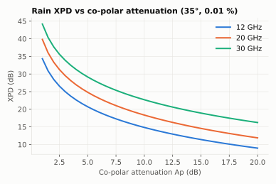
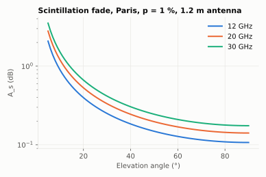

# P.618-13: Earth–space propagation data and prediction methods

**Class** `P618` · **Output** attenuation (dB), probabilities (%), XPD (dB)

The central recommendation for satellite links. This library implements:

## Rain attenuation (Section 2.2.1.1)

1. Slant path below rain: `Ls = (hR − hs)/sin θ` (hR from P.839, hs from P.1511).
2. Horizontal projection: `LG = Ls·cos θ`.
3. Rainfall rate R0.01 (P.837) and specific attenuation `γR = k·R^α` (P.838).
4. Horizontal reduction factor `r0.01 = 1/(1 + 0.78·sqrt(LG·γR/f) − 0.38·(1 − e^(−2LG)))`.
5. Effective slant length below the rain height: `LR = LG·r0.01/cos θ` when the reduced path is below the rain height (`atan((hR−hs)/(LG·r0.01)) > θ`), otherwise `LR = (hR−hs)/sin θ`.
6. Vertical adjustment `v0.01 = 1/(1 + √sin θ·(31·(1−e^(−θ/(1+χ)))·√(LR·γR)/f² − 0.45))`, with `χ = 36 − |lat|` for |lat| < 36° and 0 otherwise; effective path `LE = LR·v0.01` and `A0.01 = γR·LE`.
7. Other probabilities (0.001–5 %): `Ap = A0.01·(p/0.01)^−(0.655 + 0.033·ln p − 0.045·ln A0.01 − β(1−p)·sin θ)`, where `β = 0` for p ≥ 1 % or |lat| ≥ 36°, `β = −0.005(|lat|−36)` for |lat| < 36° and θ > 25°, and `β = −0.005(|lat|−36) + 1.8 − 4.25·sin θ` otherwise.

Rain attenuation falls with p (rarer events are deeper fades) and rises roughly with f^1.5 up to ~50 GHz.

## Other models

- `rainAttenuationProbability`: probability of exceeding a given A, with `fitRainAttenuationToLognormal` (lognormal fit with parameters m, σ).
- `siteDiversityRainOutageProbability`: joint outage for two sites; improvement vanishes with the distance between them.
- `rainCrossPolarizationDiscrimination(Ap, f, el, p, tau)`: XPD not exceeded for p %, 4–55 GHz.
- `scintillationAttenuationSigma`, `scintillationAttenuation`: tropospheric scintillation from Nwet (P.453), antenna diameter and efficiency.

## Example

Paris, 20 GHz, 35°, 45°: hs = 0.085 km, hR = 2.59 km. A0.01 = **12.11 dB**, A0.1 = 4.14 dB, A1 = 0.99 dB. Kourou A0.01 = 46.39 dB. With a measured R0.01 of 50 mm/h in Paris A0.01 = 18.14 dB. Probability of exceeding 3 dB: 6.923 %. For Ap = 5 dB: XPD = 24.8 dB. Scintillation (1.2 m dish): σ = 0.094 dB, A(1 %) = 0.28 dB. Site diversity with two stations 28.8 km apart: outage 0.01818 % at 3 dB; at 660 km: 0.00116 %.

## Notes

`P0` is expressed in %. The quantile functions agree with ITU-Rpy to ≤ 2.4e-7 relative (tolerance 2e-5). Version 14 is not implemented (see README).
