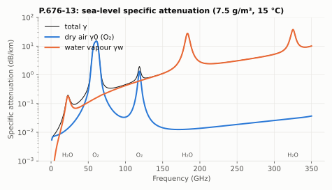
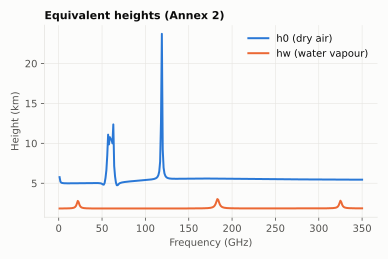
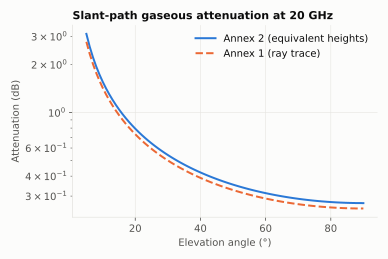

# P.676-13: attenuation by atmospheric gases

**Class** `P676` · **Output** dB or dB/km

Oxygen and water vapour absorb through discrete spectral lines. P.676-13 provides two methods:

- **Annex 1** (`Mode.EXACT`): line-by-line specific attenuation `γ = γ0 + γw` (44 oxygen lines, 35 water vapour lines, continuum), integrated by ray tracing through 922 atmospheric layers (P.835 profiles, refraction with Snell's law in spherical shells).
- **Annex 2** (`Mode.APPROX`): γ at the surface multiplied by equivalent heights `h0` and `hw` (tabulated coefficients for h0, analytic for hw), divided by `sin θ`.

Peaks: water vapour at 22 and 183 GHz, oxygen at 60 (complex) and 119 GHz. Windows near 35, 94 and 140 GHz are favourable for links.

The equivalent height of oxygen is ~5 km everywhere except near the 60 and 119 GHz oxygen lines, where it spikes (up to ~24 km at 119 GHz); water vapour ≈ 2 km, with small rises near its lines.

The two methods agree within a few percent; the ray trace is lower at low elevation because refraction shortens the path through the lower atmosphere.

## API

| Method | Notes |
|---|---|
| `gamma0Exact`, `gammaWExact`, `gammaExact(f, P, rho, T)` | specific attenuation (dB/km) |
| `slantInclinedPathEquivalentHeight(f, P, rho, T)` | `Heights(h0, hw)` |
| `gaseousAttenuationSlantPath(f, el, rho, P, T, V, h, Mode)` | total slant attenuation |
| `zenithWaterVapourAttenuation(lat, lon, p, f, ...)` | zenith water vapour (new P.676-13 constants) |
| `gaseousAttenuationTerrestrialPath(...)`, `gaseousAttenuationInclinedPath(...)` | horizontal / inclined paths |

## Example

Sea level, 7.5 g/m³, 288.15 K, 20 GHz: γ0 = 0.01188, γw = 0.09705 dB/km; at 60 GHz γ = 14.78 dB/km; at 22.235 GHz γ = 0.1923 dB/km. Equivalent heights h0 = 5.00 km, hw = 2.18 km. Slant path at 35°: Annex 2 **0.473 dB**, Annex 1 **0.437 dB**; at 5°: 3.112 vs 2.775 dB. A 10 km horizontal link at 20 GHz: 1.089 dB.

## Notes

`gamma0Approx` / `gammaWApprox` are deprecated (P.676-13 has no separate approximation) and return the line-by-line value, as ITU-Rpy does. The Annex 1/2 results are checked against the official ITU tables (see [VALIDATION.md](../VALIDATION.md)).
