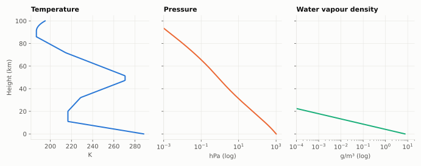

# P.835: reference standard atmospheres

**Class** `P835` · **Output** temperature, pressure, water vapour as functions of height

This is the reference (mean-annual global) atmosphere, defined by geopotential height `h`: temperature is piecewise linear, pressure follows from hydrostatic equilibrium (power law in a lapse layer, exponential in an isothermal layer), and water vapour decays exponentially: `ρ(h) = ρ0·exp(−h/h0)` with defaults `ρ0 = 7.5 g/m³` and `h0 = 2 km`.

## API

`standardTemperature(h)`, `standardPressure(h)`, `standardWaterVapourDensity(h)`, `standardWaterVapourPressure(h)`.

## Example

| h (km) | T (K) | P (hPa) | ρ (g/m³) |
|---|---|---|---|
| 0 | 288.15 | 1013.250 | 7.500 |
| 5 | 255.68 | 540.483 | 0.616 |
| 11 | 216.77 | 227.000 | 0.031 |
| 20 | 216.65 | 55.294 | 0.000 |

## Caveats

Only the reference atmosphere is implemented, not the seasonal/latitude variants.
