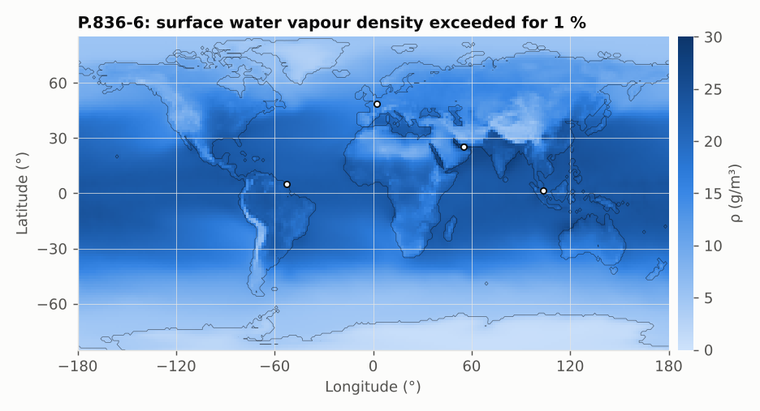
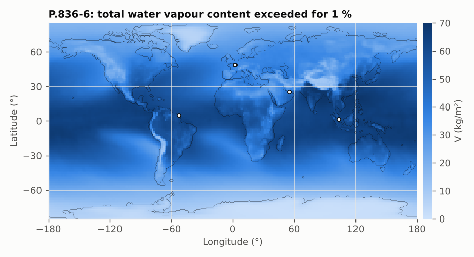
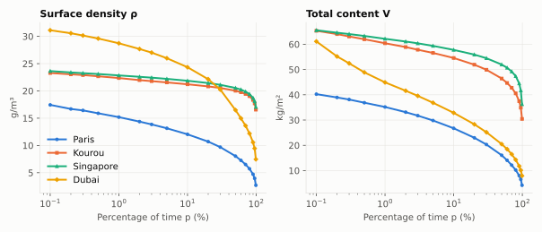

# P.836-6: water vapour, surface density and total columnar content

**Class** `P836` · **Inputs** lat, lon, p, altitude (nullable) · **Output** ρ (g/m³) or V (kg/m²)

Gridded annual statistics (1.125°) at 18 tabulated probabilities (0.1 % … 99 %). Values for other `p` are interpolated linearly in log(p), spatially with bilinear interpolation. Because maps are given at the local topographic height, a different station altitude is corrected with an exponential scale height:

```
X(alt) = X · exp(−(alt − alt_topo)/vsch)
```

where `alt_topo` comes from P.1511 (when `alt = null` the topography is used and no correction applies).






The 1 % value is high in the humid tropics (Kourou, Singapore); desert Dubai shows the largest spread from 1 % to 99 %.

## API

`surfaceWaterVapourDensity(lat, lon, p, alt)`, `totalWaterVapourContent(lat, lon, p, alt)`.

## Example

Paris, p = 1 %: ρ = 15.19 g/m³, V = **35.18 kg/m²** (26.66 at 1 km altitude; 16.07 at p = 50 %; 36.05 at p = 0.7 % by interpolation).

## Use

P.676 (zenith water vapour attenuation) and P.618 (scintillation, through P.453).
