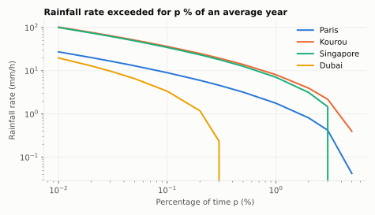
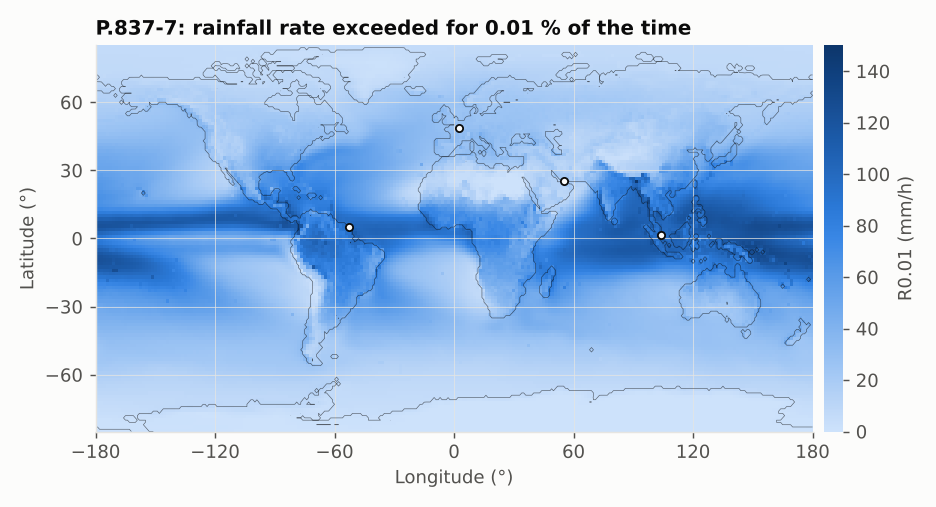

# P.837-7: rainfall rate statistics

**Class** `P837` · **Inputs** lat, lon, p · **Output** rainfall rate in mm/h exceeded for p % of an average year

Two paths:

- `p = 0.01 %`: read from the R0.01 map (bilinear).
- other `p`: monthly statistics. The probability of rain `P0` and the mean rainfall `Mt` and temperature `T` produce a lognormal-like distribution; the rate R such that `P(R) = p` is found by bisection (`Special.bisect`), using the normal survival function with the P.837-7 constants 0.7938 and 1.26. If `p > P0` the result is 0 (it does not rain that often).

Curves end where p exceeds the probability of rain (Dubai at about 0.3 %: it rarely rains there). On the log axis a zero rate is not drawn.

## API

| Method | Returns |
|---|---|
| `rainfallRate(lat, lon, p)` | R_p (mm/h) |
| `rainfallProbability(lat, lon)` | P0 (% of time with rain) |
| `unavailabilityFromRainfallRate(lat, lon, R)` | % of time R is exceeded |

## Example

Paris: R0.01 = **27.4 mm/h**, R1 = 1.78 mm/h, P0 = 5.13 %. Kourou: R0.01 = 102.3 mm/h, P0 = 5.36 %. A threshold of 20 mm/h is exceeded 0.0204 % of the time in Paris.

## Known difference

For p ≠ 0.01 the result differs from the official ITU tables by up to 3.4e-4 relative, identically to ITU-Rpy (see [VALIDATION.md](../VALIDATION.md)).
