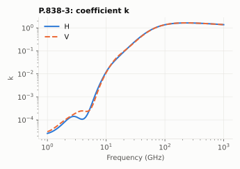
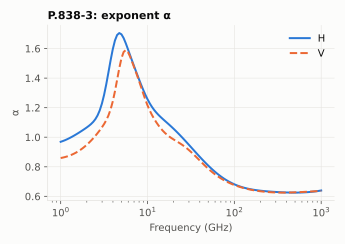
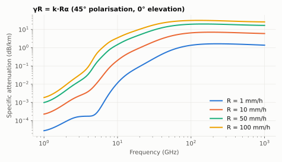

# P.838-3: specific attenuation model for rain

**Class** `org.itur.models.P838` · **Inputs** frequency, elevation, polarisation tilt, rainfall rate · **Output** γR in dB/km

Rain attenuates a signal at a rate that follows a power law of the rainfall rate R (mm/h):

```
γR = k · R^α
```

`k` and `α` depend on frequency and on polarisation. P.838 tabulates them as sums of Gaussians in log10(f) (Eqs. 2–3) for horizontal (kH, αH) and vertical (kV, αV) polarisation, then combines them for an arbitrary path (Eqs. 4–5):

```
k = [kH + kV + (kH − kV)·cos²θ·cos 2τ] / 2
α = [kH·αH + kV·αV + (kH·αH − kV·αV)·cos²θ·cos 2τ] / (2k)
```

with θ the elevation and τ the polarisation tilt (0° = horizontal, 90° = vertical, 45° = circular).

 

Reading the plots: k grows by four orders of magnitude between 1 and 100 GHz and then flattens; α peaks near 5 GHz and drops below 1 above 30 GHz, i.e. at high frequency the attenuation grows slower than linearly with rain rate. Horizontal polarisation attenuates somewhat more than vertical, mostly between 5 and 50 GHz.



## API

| Method | Returns |
|---|---|
| `coefficients(f, el, tau)` | `Coefficients(k, alpha)` |
| `rainSpecificAttenuation(R, f, el, tau)` | γR (dB/km) |

## Example

20 GHz, 35° elevation, 45° tilt: `k = 0.0939`, `α = 1.0199`. For R = 25 mm/h, γR = **2.50 dB/km** (4.70 dB/km at 30 GHz).

## Caveats

Valid 1–1000 GHz. The result is per kilometre of rain; P.618 turns it into a slant-path attenuation.
