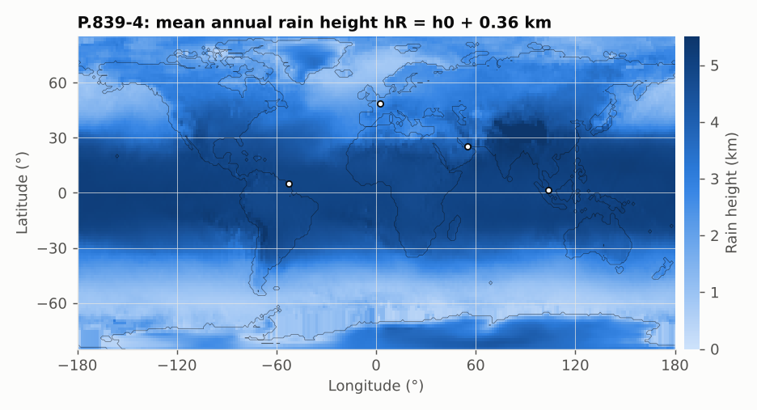

# P.839-4: rain height model

**Class** `P839` · **Inputs** lat, lon · **Output** height in km above mean sea level

Rain falls as liquid below the 0 °C isotherm. P.839 gives the mean annual 0 °C isotherm height `h0` on a 1.5° grid (bilinear interpolation) and defines the rain height as

```
hR = h0 + 0.36 km
```



The rain height follows the climate: about 5 km in the tropics, 2–3 km at mid-latitudes, close to 0 at the poles.

## API

`isotherm0(lat, lon)`, `rainHeight(lat, lon)`.

## Example

Paris: h0 = 2.23 km, hR = **2.59 km**. Kourou: 4.89 km. Oslo: 2.45 km.

## Caveats

Outside the grid (poles) values are NaN, as in ITU-Rpy. Used by P.618 for the slant-path length `Ls = (hR − hs)/sin θ`.
