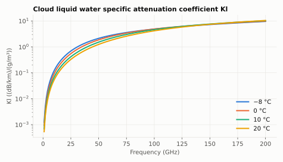
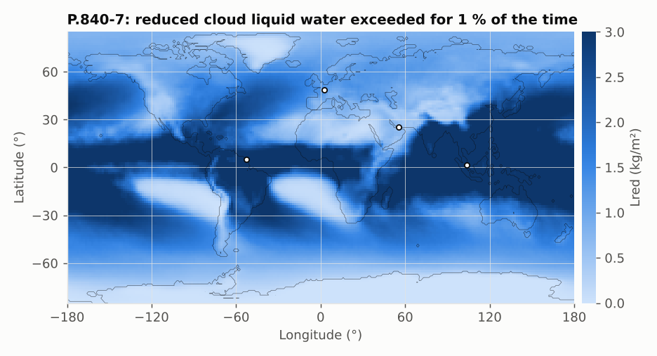

# P.840-7: attenuation due to clouds and fog

**Class** `P840` · **Output** cloud attenuation in dB

Clouds are modelled by their columnar content of liquid water; the attenuation is

```
Ac = Lred · Kl(f, 0 °C) / sin θ
```

- `Lred` is the reduced liquid water content (kg/m², normalised to 0 °C) exceeded for p %, from a map with log-interpolation in p (valid for p ≤ 99 %).
- `Kl` (dB/km per g/m³) is the specific attenuation coefficient from a double-Debye model of liquid water permittivity (Eqs. 2–11).



Kl rises with frequency; temperature matters most below ~50 GHz (warmer water attenuates less). P.840-7 evaluates Kl at 0 °C because Lred is already scaled to that temperature.



## API

`columnarContentReducedLiquid(lat, lon, p)`, `specificAttenuationCoefficient(f, T°C)`, `cloudAttenuation(lat, lon, el, f, p, Double lred)`, `lognormalApproximationCoefficients(...)`.

## Example

Paris, p = 1 %: Lred = 1.24 kg/m² (1.84 at p = 0.1 %). At 20 GHz Kl(0 °C) = 0.359 (0.212 at 20 °C). At 35° elevation: Ac = **0.78 dB**.

## Caveats

Error for p > 99 %. P.840-7 has no lognormal attenuation model (removed from this version).
