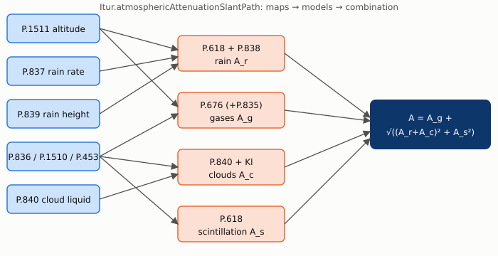

# Recommendations guide

One page per ITU-R Recommendation implemented by this library: what it models, the equations as coded, the API, a worked example and figures. All numbers and plots are computed with this library (`tools/DocFigureData.java` → `tools/plot_doc_figures.py`).

| Page | Recommendation | Class | Role in a link budget |
|---|---|---|---|
| [P.618](P618.md) | P.618-13 | `P618` | rain attenuation, scintillation, cross-polarisation, site diversity |
| [Combined](ITUR.md) | — | `Itur` | combination of all contributions |
| [P.676](P676.md) | P.676-13 | `P676` | gaseous attenuation (oxygen, water vapour) |
| [P.840](P840.md) | P.840-7 | `P840` | cloud attenuation |
| [P.837](P837.md) | P.837-7 | `P837` | rainfall rate statistics |
| [P.838](P838.md) | P.838-3 | `P838` | rain specific attenuation coefficients |
| [P.839](P839.md) | P.839-4 | `P839` | rain height |
| [P.453](P453.md) | P.453-13 | `P453` | radio refractive index |
| [P.836](P836.md) | P.836-6 | `P836` | water vapour density and content |
| [P.1510](P1510.md) | P.1510-1 | `P1510` | surface temperature |
| [P.1511](P1511.md) | P.1511-1 | `P1511` | topographic altitude |
| [P.835](P835.md) | P.835 | `P835` | standard atmosphere |

**How they fit together.** The map-based recommendations (P.1511, P.837, P.839, P.836, P.1510, P.453, P.840) turn a latitude/longitude into local climate statistics. The calculation recommendations (P.618, P.838, P.676, P.840) turn those statistics, the frequency and the elevation angle into decibels. `Itur.atmosphericAttenuationSlantPath` combines them: `A = Ag + sqrt((Ar + Ac)² + As²)`.

## Conventions

Latitude/longitude in degrees (longitude may be 0..360 or −180..180), frequency in GHz, heights in km, probability `p` in % of an average year, temperatures in K unless noted, nullable `Double` = optional input derived from the maps when `null`.

## Worked-example site

Unless stated otherwise the examples use Paris (48.85° N, 2.35° E), 20 GHz, 35° elevation, 45° polarisation tilt, 1.2 m antenna. The comparison cities in the figures are Paris, Kourou (5.16° N, 52.65° W), Singapore (1.35° N, 103.82° E) and Dubai (25.20° N, 55.27° E). Maps show land outlines derived from the P.1511 data (altitude > 0), city locations are the white dots.

For how each model is validated, see [VALIDATION.md](../VALIDATION.md).
